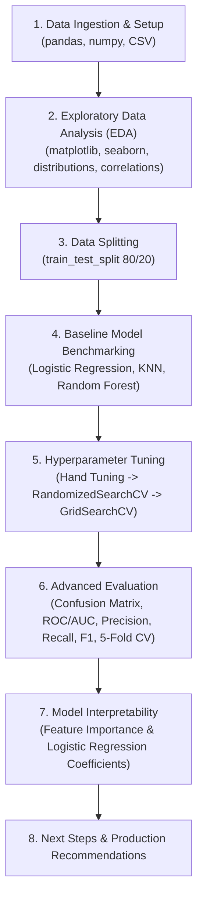

# Heart Disease Classification: End-to-End Machine Learning Recap

Welcome to the comprehensive recap of the Heart Disease Classification project! This guide is written specifically for **beginner machine learning enthusiasts**. It walks through every step we took from start to finish, explaining **what** we did, **what tools** we used, **why** we used them, and **what the results mean**.

---

## 🧭 Project Blueprint & Architecture

Here is the high-level roadmap of the machine learning workflow implemented in this project:



---

## 1. Problem Formulation & Setup

### What We Did
- Defined the core problem: **Binary Classification**.
- Target: Predict whether a patient has heart disease (`target = 1`) or not (`target = 0`) based on 13 clinical attributes (such as age, sex, chest pain type, resting blood pressure, cholesterol, max heart rate, etc.).
- Created an organized folder structure with a dedicated `plots/` directory to automatically persist every chart.

### Tools & Libraries Used
- **Python**: Programming language for data science and machine learning.
- **Pandas**: High-performance data structures (`DataFrame`, `Series`) for reading tabular CSV data, indexing, slicing, aggregation, and summary statistics.
- **NumPy**: Fast numerical computing, multidimensional array operations, and random seeding (`np.random.seed(42)`).
- **Matplotlib & Seaborn**: Data visualization libraries to plot distributions, relationships, correlations, and model metrics.
- **OS module (`os.makedirs`)**: Handled filesystem directory creation programmatically to prevent `FileNotFoundError`.

### Why np.random.seed(42)?
In machine learning, algorithms often involve stochastic (random) processes — such as randomly splitting train and test sets or initializing model weights. Setting a fixed random seed (42 is a classic community standard) guarantees **reproducibility**: anyone running the code will get the exact same split and identical scores.

---

## 2. Exploratory Data Analysis (EDA)

Before feeding data into machine learning models, you must understand your data. EDA answers:
1. Are there missing values or invalid data types?
2. Is the dataset balanced or severely imbalanced?
3. Which features correlate with the target or with each other?

### What We Executed & Discovered
1. **Dataset Inspection (`dataset.info()`, `dataset.describe()`, `dataset.isna().sum()`)**:
   - 303 rows (patients) and 14 columns (13 features + 1 target).
   - Zero missing values (`isna().sum() == 0`), which meant no imputation (filling missing data) was required.
2. **Target Distribution**:
   - `165` patients had heart disease (`target = 1`), and `138` did not (`target = 0`).
   - The classes are balanced (~54% vs ~46%), meaning standard accuracy is a viable starting metric and class reweighting is not strictly required.
   - Saved plot: [`plots/01_heart_disease_frequency.png`](plots/01_heart_disease_frequency.png).
3. **Gender vs. Heart Disease (`pd.crosstab(dataset['sex'], dataset['target'])`)**:
   - Female patients (`sex = 0`) had a ~75% chance of heart disease in this dataset.
   - Male patients (`sex = 1`) had a ~45% chance of heart disease.
   - Saved plot: [`plots/02_frequency_by_sex.png`](plots/02_frequency_by_sex.png).
4. **Age vs. Max Heart Rate (`thalach`)**:
   - Younger patients generally achieved higher maximum heart rates.
   - Patients with heart disease often showed higher heart rates even at older ages.
   - Saved plot: [`plots/03_age_vs_max_heart_rate.png`](plots/03_age_vs_max_heart_rate.png).
5. **Age Distribution**:
   - Normally distributed (bell curve) centered between ages 50 and 65.
   - Saved plot: [`plots/04_age_distribution.png`](plots/04_age_distribution.png).
6. **Chest Pain Type (`cp`) vs. Target**:
   - `cp = 0`: Typical angina (lower disease rate in this dataset).
   - `cp = 1, 2, 3`: Atypical angina, non-anginal pain, or asymptomatic. Patients with non-anginal pain (`cp = 2`) had a significantly higher rate of heart disease (~79%).
   - Saved plot: [`plots/05_chest_pain_vs_target.png`](plots/05_chest_pain_vs_target.png).
7. **Correlation Matrix Heatmap (`dataset.corr()`)**:
   - Measured linear relationships between all pairs of features using Pearson's correlation coefficient $r \in [-1, 1]$.
   - Positive correlations with `target`: `cp` (+0.43), `thalach` (+0.42), `slope` (+0.35).
   - Negative correlations with `target`: `oldpeak` (-0.43), `exang` (-0.44), `ca` (-0.39), `sex` (-0.28).
   - Saved plot: [`plots/correlation_matrix_heatmap.png`](plots/correlation_matrix_heatmap.png).

---

## 3. Data Splitting: Train vs. Test

### What We Did
```python
X = dataset.drop("target", axis=1)
y = dataset["target"]
X_train, X_test, y_train, y_test = train_test_split(X, y, test_size=0.2, random_state=42)
```

### Why Do We Split the Data?
The golden rule in machine learning is: **never evaluate a model on the same data it learned from**.
- **Training Set (80%, 242 rows)**: Used by the algorithms to discover patterns, adjust weights, and learn decision boundaries.
- **Test Set (20%, 61 rows)**: Kept strictly hidden during training. It serves as a simulation of future, unseen patient records to test the model's true **generalization capacity**.
- If you test on training data, the model can simply memorize the answers (an issue called **overfitting**), looking great in practice but failing in the real world.

---

## 4. Baseline Modeling & Evaluation

Instead of jumping directly into complex models, a disciplined machine learning practitioner builds several simple **baseline models** to establish performance benchmarks.

### The 3 Models We Tested

| Model | Category | How It Works | Why We Tested It |
| :--- | :--- | :--- | :--- |
| **Logistic Regression** | Linear / Generalized Linear Model | Uses the sigmoid/logistic function $\sigma(z) = \frac{1}{1 + e^{-z}}$ to map a linear combination of inputs to a probability between 0 and 1. | Industry standard baseline for tabular binary classification. Extremely fast, lightweight, and highly interpretable. |
| **K-Nearest Neighbors (KNN)** | Non-parametric / Instance-based | Does not "learn" explicit weights. Instead, to classify a new patient, it calculates Euclidean distances to all training points and assigns the majority class of the $K$ closest neighbors. | Simple, intuitive non-linear algorithm that captures local clusters of similar patients. |
| **Random Forest** | Ensemble / Tree-based | Builds an "ensemble" of multiple Decision Trees (e.g., 100 trees), each trained on a bootstrap sample of data with random feature subsets. Predictions are made by majority vote. | Robust to non-linear interactions, resistant to outliers, and inherently reduces individual tree variance through bagging. |

### Baseline Comparison Results

```python
model_scores = {
    "Logistic Regression": 0.8852 (88.52%),
    "KNN": 0.6885 (68.85%),
    "Random Forest": 0.8361 (83.61%)
}
```

- **Logistic Regression** took the lead immediately with **88.52% accuracy**, followed by Random Forest (83.61%), and KNN lagged behind at (68.85%).
- Saved plot: [`plots/06_model_comparison.png`](plots/06_model_comparison.png).

---

## 5. Hyperparameter Tuning

### What is the Difference Between Parameters and Hyperparameters?
- **Parameters**: Internal variables that the model learns on its own from data during training (e.g., coefficients $\beta_i$ in Logistic Regression, split thresholds in Decision Trees).
- **Hyperparameters**: External settings that **you** configure before training starts to guide how the algorithm learns (e.g., $K$ in KNN, number of trees in Random Forest, regularization strength $C$ in Logistic Regression).

### 1. Manual / Hand Tuning (KNN)
We trained 20 different KNN models by testing every $K$ value from 1 to 20:
- When $K=1$, training accuracy was 100%, but test accuracy was low (~62%). This is a textbook example of **overfitting** (memorizing individual points).
- Increasing $K$ reduced variance and improved test performance, peaking at **$K=11$** with **75.41% accuracy**.
- Even tuned to 75.41%, KNN still lagged behind Logistic Regression (88.52%) and Random Forest (83.61%). We dropped KNN from further tuning.
- Saved plot: [`plots/07_knn_tuning.png`](plots/07_knn_tuning.png).

### 2. Tuning with `RandomizedSearchCV`
Hand-tuning multiple hyperparameters across multiple models is impractical because the combinations grow exponentially. 
- **`RandomizedSearchCV`** randomly samples a specified number of hyperparameter combinations (e.g., `n_iter=20`) from predefined grids and tests each combination using **5-fold cross-validation** (100 total fits).
- Tuned hyperparameters:
  - **LogisticRegression**: `C` (inverse regularization strength over a log scale from $10^{-4}$ to $10^4$) and `solver` (`liblinear`).
  - **RandomForestClassifier**: `n_estimators`, `max_depth`, `min_samples_split`, `min_samples_leaf`.
- **Results**:
  - `LogisticRegression`: achieved **88.52%** test accuracy with `C ≈ 0.2336`, `solver='liblinear'`.
  - `RandomForestClassifier`: improved to **86.89%** test accuracy.

### 3. Fine-Tuning with `GridSearchCV`
Since Logistic Regression was our top performer, we focused exclusively on it for exhaustive tuning.
- While `RandomizedSearchCV` samples randomly to cover broad ranges, **`GridSearchCV`** tests **every single combination** in a specified search space.
- We set up a tightly focused grid of 30 values for $C$ around the best region found by `RandomizedSearchCV`.
- Result: Best parameter was `C = 0.2043`, achieving **88.52%** accuracy on the holdout test set.

---

## 6. Advanced Evaluation (Beyond Accuracy)

In clinical applications, **accuracy alone can be dangerous**. For instance, a model with 90% accuracy that predicts "no disease" for 100% of sick patients could have catastrophic real-world consequences. We evaluated our best tuned model across multiple comprehensive metrics.

### 1. The Confusion Matrix
A $2 \times 2$ table showing where the model was right and where it made mistakes:

| | Predicted: No Disease (`0`) | Predicted: Disease (`1`) |
| :---: | :---: | :---: |
| **Actual: No Disease (`0`)** | **True Negative (TN) = 25** | False Positive (FP) = 4 |
| **Actual: Disease (`1`)** | False Negative (FN) = 3 | **True Positive (TP) = 29** |

- **Type I Error (False Positive)**: 4 healthy patients were told they have disease (leads to unnecessary stress and further tests).
- **Type II Error (False Negative)**: 3 sick patients were told they are healthy (the most dangerous clinical outcome).
- Saved plot: [`plots/09_confusion_matrix.png`](plots/09_confusion_matrix.png).

### 2. Precision, Recall, and F1-Score
- **Precision**: Out of all patients predicted to have disease, how many actually had it?
  $$\text{Precision} = \frac{\text{TP}}{\text{TP} + \text{FP}} = \frac{29}{29 + 4} = 87.88\%$$
- **Recall (Sensitivity)**: Out of all patients who genuinely had disease, how many did the model detect?
  $$\text{Recall} = \frac{\text{TP}}{\text{TP} + \text{FN}} = \frac{29}{29 + 3} = 90.62\%$$
- **F1-Score**: The harmonic mean balancing Precision and Recall:
  $$\text{F1} = 2 \times \frac{\text{Precision} \times \text{Recall}}{\text{Precision} + \text{Recall}} = 89.23\%$$

### 3. ROC Curve & AUC (Area Under Curve)
- The **Receiver Operating Characteristic (ROC)** curve plots the **True Positive Rate (Recall)** against the **False Positive Rate** across every possible probability threshold (from 0 to 1).
- **AUC (Area Under Curve)** measures overall separation capability:
  - 0.5 = random coin toss.
  - 1.0 = perfect classifier.
  - Our tuned Logistic Regression achieved an **AUC of 0.93**, indicating excellent discriminative power.
- Saved plot: [`plots/08_roc_curve.png`](plots/08_roc_curve.png).

### 4. 5-Fold Cross-Validation (`cross_val_score`)
Evaluating on a single train/test split can be biased by chance (getting an easy or hard test batch). 
- With **5-fold cross-validation**, the dataset is divided into 5 equal subsets. The model is trained on 4 and tested on 1, repeating 5 times so every sample is tested once.
- **Cross-Validated Averages**:
  - **Accuracy**: $84.47\%$
  - **Precision**: $82.08\%$
  - **Recall**: $92.16\%$ (noticeably high, which is ideal for medical screening!)
  - **F1-Score**: $86.73\%$
- Saved plot: [`plots/10_cv_metrics.png`](plots/10_cv_metrics.png).

---

## 7. Model Interpretability & Feature Importance

Machine learning models should not be opaque black boxes, especially in healthcare. Clinicians need to know *why* a model makes a specific prediction.

### How Logistic Regression Provides Feature Importance
In Logistic Regression, the prediction is computed via the log-odds equation:
$$\log\left(\frac{p}{1-p}\right) = \beta_0 + \beta_1 x_1 + \beta_2 x_2 + \dots + \beta_n x_n$$

The learned weights (`clf.coef_`) represent the direct contribution of each clinical feature:
- **Positive coefficient ($\beta > 0$)**: An increase in this feature increases the likelihood of heart disease (`target = 1`).
- **Negative coefficient ($\beta < 0$)**: An increase in this feature decreases the likelihood of heart disease (or points toward `target = 0`).

### Feature Importance Findings
- **Strongest Positive Drivers**:
  - `cp` (+0.66): Higher chest pain index (atypical/non-anginal) strongly increases risk of heart disease.
  - `slope` (+0.45): Upsloping ST segment during peak exercise is positively associated with disease.
  - `restecg` (+0.32): Resting electrocardiographic abnormalities increase risk.
- **Strongest Negative Drivers**:
  - `sex` (-0.86): Females (`0`) showed higher disease prevalence in this specific cohort than males (`1`).
  - `thal` (-0.68): Reversible defects indicated lower odds compared to normal perfusion in this encoding.
  - `ca` (-0.64): Number of major vessels colored by flourosopy.
  - `exang` (-0.60): Exercise-induced angina.
- Saved plot: [`plots/11_feature_importance.png`](plots/11_feature_importance.png).

---

## 8. Summary Table of Key Scikit-Learn Classes Used

| Class / Function | Module | What It Does In This Project |
| :--- | :--- | :--- |
| `train_test_split` | `sklearn.model_selection` | Partitions features and labels into training (80%) and testing (20%) sets. |
| `LogisticRegression` | `sklearn.linear_model` | Fits our best-performing linear classification baseline. |
| `KNeighborsClassifier` | `sklearn.neighbors` | Fits distance-based nearest neighbors classifier. |
| `RandomForestClassifier` | `sklearn.ensemble` | Fits ensemble of randomized decision trees. |
| `RandomizedSearchCV` | `sklearn.model_selection` | Explores a broad hyperparameter space with randomized combinations and 5-fold CV. |
| `GridSearchCV` | `sklearn.model_selection` | Performs an exhaustive search over fine-tuned hyperparameter values. |
| `ConfusionMatrixDisplay` | `sklearn.metrics` | Computes and visually renders the confusion matrix heatmap. |
| `RocCurveDisplay` | `sklearn.metrics` | Computes and plots the ROC curve along with the AUC metric. |
| `classification_report` | `sklearn.metrics` | Outputs a text summary of Precision, Recall, F1-score, and support. |
| `cross_val_score` | `sklearn.model_selection` | Calculates cross-validated scores across multiple folds for any evaluation metric. |

---

## 9. Gallery of Generated Project Visualizations

All 11 generated plots are saved in the [`plots/`](plots/) directory:

1. **[`plots/01_heart_disease_frequency.png`](plots/01_heart_disease_frequency.png)** — Target distribution bar chart showing class balance.
2. **[`plots/02_frequency_by_sex.png`](plots/02_frequency_by_sex.png)** — Disease frequency comparison between female and male cohorts.
3. **[`plots/03_age_vs_max_heart_rate.png`](plots/03_age_vs_max_heart_rate.png)** — Scatter plot showing relationship between age, max heart rate (`thalach`), and target.
4. **[`plots/04_age_distribution.png`](plots/04_age_distribution.png)** — Histogram showing age distribution of patients.
5. **[`plots/05_chest_pain_vs_target.png`](plots/05_chest_pain_vs_target.png)** — Grouped bar chart comparing heart disease frequency across 4 chest pain types.
6. **[`plots/06_model_comparison.png`](plots/06_model_comparison.png)** — Baseline accuracy comparison between Logistic Regression, KNN, and Random Forest.
7. **[`plots/07_knn_tuning.png`](plots/07_knn_tuning.png)** — KNN train vs test curve across $K=1 \dots 20$ showing the overfitting-to-underfitting spectrum.
8. **[`plots/08_roc_curve.png`](plots/08_roc_curve.png)** — ROC curve and AUC score ($0.93$) for the tuned Logistic Regression model.
9. **[`plots/09_confusion_matrix.png`](plots/09_confusion_matrix.png)** — Confusion matrix breakdown (TP, TN, FP, FN).
10. **[`plots/10_cv_metrics.png`](plots/10_cv_metrics.png)** — 5-fold cross-validated performance metrics (Accuracy, Precision, Recall, F1).
11. **[`plots/11_feature_importance.png`](plots/11_feature_importance.png)** — Logistic Regression feature importance coefficients.
12. **[`plots/correlation_matrix_heatmap.png`](plots/correlation_matrix_heatmap.png)** — Complete correlation matrix heatmap across all features.
13. **[`plots/visualizations_overview.png`](plots/visualizations_overview.png)** — 2x2 multi-panel exploratory analysis overview.

---

## 10. Model Serialization & Export

Once the model was tuned, cross-validated, and interpreted, we exported it for production deployment and future inference:
- **`models/heart_disease_model.joblib`**: Scikit-Learn's recommended serialization format using `joblib`.
- **`models/heart_disease_model.pkl`**: Standard Python `pickle` format.

### How to Load and Use the Exported Model
```python
import joblib
import pandas as pd

# 1. Load the trained model
model = joblib.load("models/heart_disease_model.joblib")

# 2. Make predictions on new patient records (13 clinical features)
# Example: 1 = Disease, 0 = No Disease
new_patient = pd.DataFrame([{
    "age": 63, "sex": 1, "cp": 3, "trestbps": 145, "chol": 233,
    "fbs": 1, "restecg": 0, "thalach": 150, "exang": 0,
    "oldpeak": 2.3, "slope": 0, "ca": 0, "thal": 1
}])

prediction = model.predict(new_patient)
probabilities = model.predict_proba(new_patient)

print("Prediction:", "Disease" if prediction[0] == 1 else "No Disease")
print(f"Confidence: {probabilities[0][prediction[0]]:.2%}")
```

### Running the Interactive Streamlit Web Application
We wrapped our serialized model into an interactive clinical risk dashboard ([`app.py`](app.py)).

To launch the app locally:
```bash
streamlit run app.py
```
This opens a local browser interface where you can:
- Input patient biomarkers (demographics, vital signs, ECG, stress tests).
- Select quick-load patient profiles (Healthy, High Risk, Cleveland Dataset sample).
- View real-time probability gauges and clinical recommendations.
- Inspect model coefficients and training evaluation plots.

---

## 11. Next Steps & Ideas for Further Exploration

If you want to continue improving this project, here are four impactful machine learning experiments to try next:
1. **Feature Scaling (`StandardScaler` or `MinMaxScaler`)**: While tree models do not require scaling, distance-based models (KNN) and regularized linear models (Logistic Regression) often benefit when features with large ranges (e.g., `chol`, `thalach`, `trestbps`) are normalized.
2. **Collect More Data**: 303 samples is a small dataset for modern machine learning; acquiring additional clinical observations will improve model robustness.
3. **Gradient Boosting Algorithms**: Benchmark gradient-boosted decision tree libraries such as **XGBoost**, **LightGBM**, or **CatBoost**.
4. **Interactive Web App**: Wrap the exported model (`models/heart_disease_model.joblib`) into a lightweight **Streamlit** dashboard or a **FastAPI** endpoint for real-time patient risk assessment.

